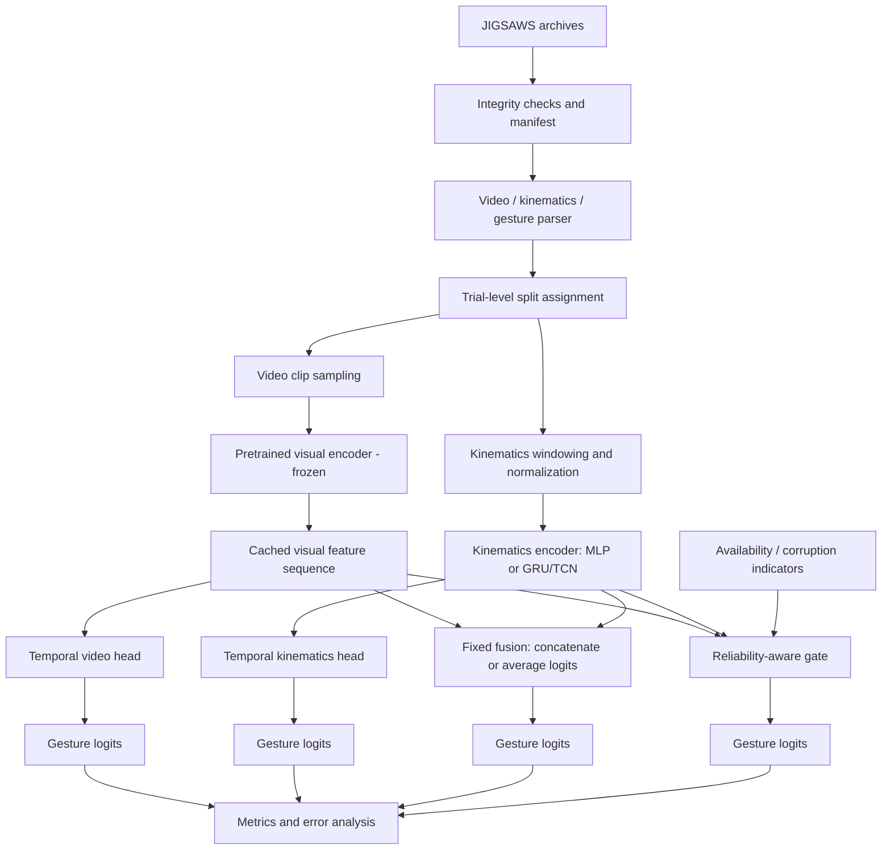

# System architecture

## Design principles
- Start from verified data, not model assumptions.
- Freeze the visual encoder initially.
- Cache expensive video features.
- Keep unimodal and fixed-fusion baselines before adaptive fusion.
- Make missingness/reliability indicators explicit.
- Keep experiment configuration and split files versioned.

## Architecture diagram

## Components and interfaces

| Component | Purpose | Input | Output | Recommendation |
|---|---|---|---|---|
| Manifest builder | One source of truth for trial paths and metadata | Dataset files | CSV/Parquet/JSONL manifest | Required |
| Annotation parser | Maps frame/time to gesture labels | Annotation files | Per-frame or segment label records | Required |
| Split builder | Prevents leakage | Trial/user metadata | Versioned split file | Required |
| Video sampler | Creates reproducible clips/windows | Video + timestamps | Clip tensors or sampled frame paths | Required |
| Visual encoder | Produces pretrained representations | Clip/frame batch | Feature vectors/tokens | Freeze initially; checkpoint verification gate |
| Feature cache | Avoids repeated encoder inference | Trial clips | Feature arrays + metadata | Required if encoder is expensive |
| Kinematics preprocessing | Cleans and normalizes numeric sequences | Raw kinematics | Aligned normalized windows | Required |
| Kinematics encoder | Models motion | Kinematic windows | Sequence embedding | Small MLP first; GRU/TCN as temporal comparison |
| Temporal head | Predicts gesture sequence | Feature sequence | Per-timestep logits | Start with linear/MLP head; then GRU/TCN |
| Fixed fusion | Baseline multimodal combination | Video and kinematics embeddings/logits | Fused logits | Required |
| Adaptive gate | Weights modalities per window | Embeddings + reliability/availability flags | Weights and logits | Optional after baseline |
| Evaluator | Calculates metrics and exports predictions | Labels and logits | Metrics, confusion matrix, prediction CSV | Required |
| Experiment logger | Captures config, seed, commit, runtime | Run config/results | JSON/CSV/logs | Required |

## Fusion design

### Baseline 1: late-logit fusion
Train separate video-only and kinematics-only heads. Combine calibrated logits with a fixed weighted sum; choose weights only on validation data. This is easy to debug and provides a clear baseline.

### Baseline 2: feature concatenation
Concatenate projected video and kinematics embeddings and feed a small MLP/temporal head. This tests feature-level fusion without a graph network.

### Proposed adaptive fusion
Use a small gating network to produce weights `alpha_video` and `alpha_kinematics` from projected modality embeddings plus explicit availability/reliability features. Fuse projected features or logits. If a modality is missing, mask its gate weight and renormalize over available modalities. Do not let the gate inspect ground-truth labels or test metrics.

Reliability signals should be observable at inference time, such as modality-present flags, missing-value fraction, signal-validity checks, or a learned confidence score. Do not invent a reliability score without defining and validating it.

## Temporal modeling
Compare:
1. Independent timestep classifier (no learned temporal context).
2. Small GRU or TCN over cached feature sequences.
3. Optional temporal smoothing as a non-learned baseline.

Use identical trial splits and as comparable a feature window as possible. Avoid bidirectional temporal context if the intended use is online recognition; for this offline mini-project, state clearly whether the model uses future frames.

## Loss and optimization
- Multiclass cross-entropy for gesture classification.
- Optional class-weighted cross-entropy only if training-label imbalance warrants it; calculate weights on training data only.
- AdamW or Adam with a small learning rate for newly initialized heads; tune only on validation.
- Early stopping on a predeclared validation metric.
- Freeze encoder in the MVP. Fine-tuning is deferred.

## Interfaces
- Manifest record: `trial_id`, `user_id` if available, `task`, `video_path`, `kinematics_path`, `annotation_path`, `fps`, `n_frames`, `n_kinematic_samples`, and verified alignment fields.
- Feature record: `trial_id`, frame/time indices, feature array, encoder ID/version, preprocessing ID.
- Prediction record: `trial_id`, time/frame index, true label, predicted label, per-class scores, modality condition, seed, model config ID.

## Error handling
Fail loudly on mismatched sequence lengths, invalid labels, missing timestamps, non-finite kinematics, or split leakage. Do not silently truncate or infer alignment from filenames unless that convention is verified.
